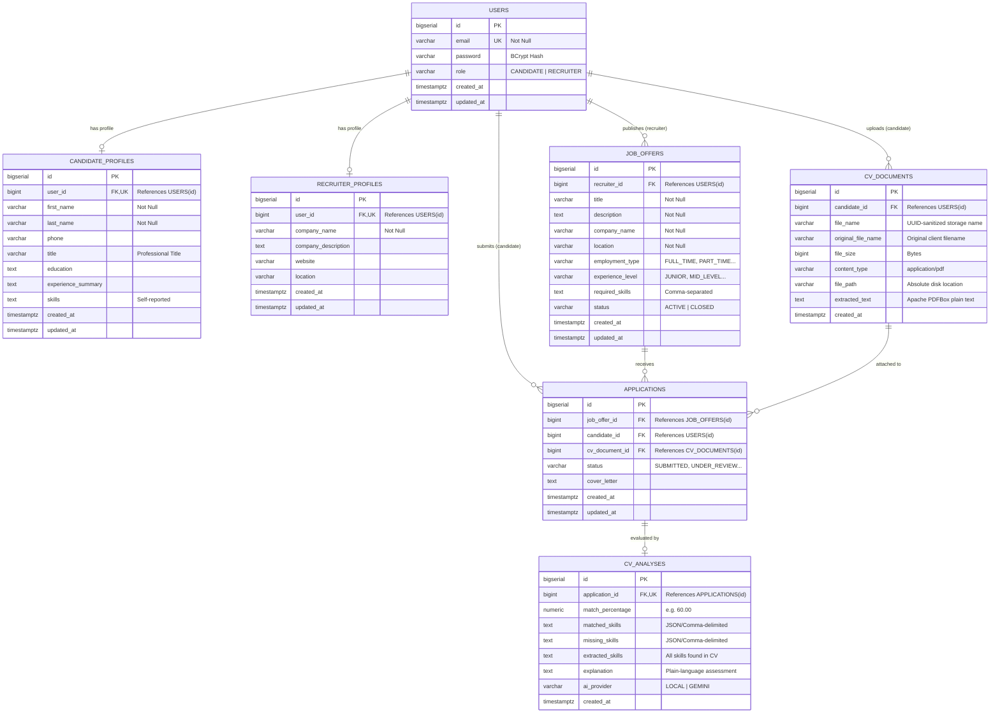

# HireSmart AI — Database Design & Schema Specification
**Final-Year Engineering Project (PFE) — Software Development & Information Technology**

---

## 1. Overview & Data Architecture

HireSmart AI uses **PostgreSQL 16** as its relational persistence engine. Database schema management is strictly version-controlled using **Flyway migrations** (`db/migration/V1__init_schema.sql`, `db/migration/V2__seed_demo_data.sql`), preventing destructive schema overwrites and ensuring reproducible database deployments across Docker environments.

---

## 2. Entity-Relationship (ER) Diagram

---

## 3. Data Dictionary & Table Definitions

### 3.1 Table `users`
| Column | Type | Constraints | Description |
| :--- | :--- | :--- | :--- |
| `id` | `BIGSERIAL` | Primary Key | Unique internal user identifier |
| `email` | `VARCHAR(255)` | Unique, Not Null | Account authentication email address |
| `password` | `VARCHAR(255)` | Not Null | BCrypt salted hash |
| `role` | `VARCHAR(50)` | Not Null | `CANDIDATE` or `RECRUITER` |
| `created_at` | `TIMESTAMPTZ` | Default `NOW()` | Account creation timestamp |
| `updated_at` | `TIMESTAMPTZ` | Default `NOW()` | Timestamp of last credential update |

### 3.2 Table `job_offers`
| Column | Type | Constraints | Description |
| :--- | :--- | :--- | :--- |
| `id` | `BIGSERIAL` | Primary Key | Job position identifier |
| `recruiter_id`| `BIGINT` | FK `users(id)` ON DELETE CASCADE | Recruiter account managing the position |
| `title` | `VARCHAR(255)` | Not Null | Position title |
| `company_name`| `VARCHAR(255)` | Not Null | Company publishing the posting |
| `location` | `VARCHAR(255)` | Not Null | Work location or Remote |
| `employment_type`| `VARCHAR(50)` | Not Null | `FULL_TIME`, `PART_TIME`, `CONTRACT`, `INTERNSHIP` |
| `experience_level`| `VARCHAR(50)` | Not Null | `JUNIOR`, `MID_LEVEL`, `SENIOR`, `LEAD` |
| `required_skills`| `TEXT` | Not Null | Technical skills for AI evaluation |
| `status` | `VARCHAR(50)` | Default `'ACTIVE'` | `ACTIVE` (open) or `CLOSED` |

### 3.3 Table `applications`
| Column | Type | Constraints | Description |
| :--- | :--- | :--- | :--- |
| `id` | `BIGSERIAL` | Primary Key | Application identifier |
| `job_offer_id`| `BIGINT` | FK `job_offers(id)` ON DELETE CASCADE | Target job posting |
| `candidate_id`| `BIGINT` | FK `users(id)` ON DELETE CASCADE | Applying candidate |
| `cv_document_id`| `BIGINT` | FK `cv_documents(id)` ON DELETE SET NULL | Resume document snapshot |
| `status` | `VARCHAR(50)` | Default `'SUBMITTED'` | `SUBMITTED`, `UNDER_REVIEW`, `INTERVIEW`, `ACCEPTED`, `REJECTED` |
| `cover_letter`| `TEXT` | Nullable | Candidate note or remarks |

> **Crucial Integrity Constraint**:
> `CONSTRAINT uk_job_candidate UNIQUE (job_offer_id, candidate_id)` prevents candidate accounts from submitting duplicate applications to the same job.

### 3.4 Table `cv_analyses`
| Column | Type | Constraints | Description |
| :--- | :--- | :--- | :--- |
| `id` | `BIGSERIAL` | Primary Key | Analysis record identifier |
| `application_id`| `BIGINT` | FK `applications(id)` UNIQUE | Attached application |
| `match_percentage`| `NUMERIC(5,2)` | Not Null | Calculated skills overlap percentage |
| `matched_skills`| `TEXT` | Nullable | Documented skills required by the job |
| `missing_skills`| `TEXT` | Nullable | Required skills missing in the CV |
| `extracted_skills`| `TEXT` | Nullable | Complete inventory of detected skills |
| `explanation` | `TEXT` | Nullable | Plain-language evaluation explanation |
| `ai_provider` | `VARCHAR(50)` | Default `'LOCAL'` | `LOCAL` or `GEMINI` |

---

## 4. Indexing & Query Optimization

| Index Name | Table | Columns | Purpose |
| :--- | :--- | :--- | :--- |
| `idx_users_email` | `users` | `email` | Rapid $O(1)$ user lookup on login |
| `idx_job_offers_status`| `job_offers`| `status` | High-frequency filtering of active jobs |
| `idx_job_offers_recruiter`| `job_offers`| `recruiter_id` | Recruiter dashboard jobs listing |
| `idx_applications_job` | `applications`| `job_offer_id` | Pipeline filtering by job offer |
| `idx_applications_candidate`| `applications`| `candidate_id`| Candidate application history tracking |
| `idx_applications_status`| `applications`| `status` | Recruiter pipeline status aggregations |
| `idx_cv_documents_candidate`| `cv_documents`| `candidate_id`| Retrieving candidate's latest CV |
