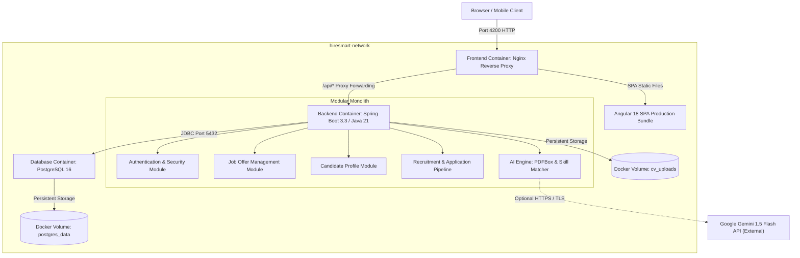
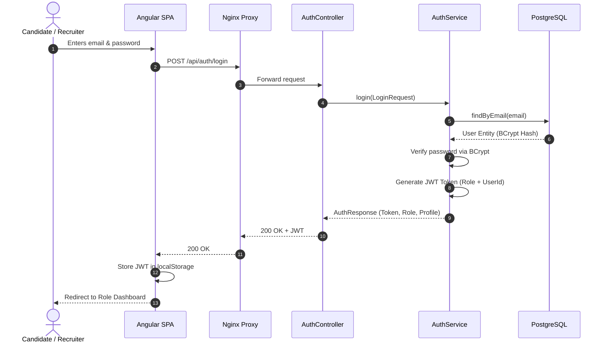
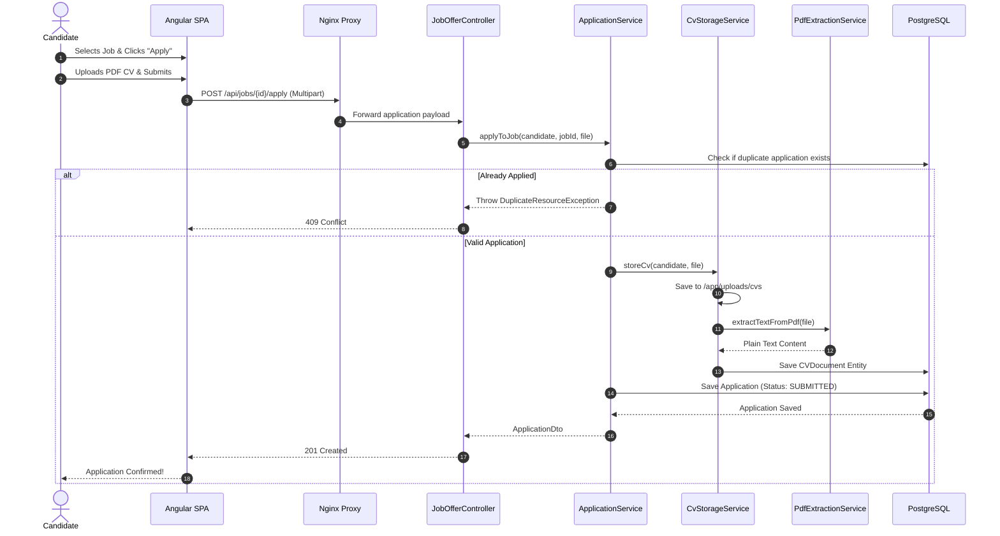
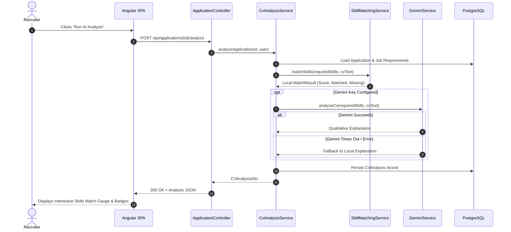

# HireSmart AI — Software Architecture Document
**Final-Year Engineering Project (PFE) — Software Development & Information Technology**

---

## 1. Architectural Philosophy & Justification

HireSmart AI is built upon a **Modular Monolith Architecture**. While microservices are widely discussed in contemporary literature, industry consensus and software engineering empirical data confirm that for applications with coherent domains and focused deployment teams, microservices introduce premature complexity:
- Network latency and distributed transaction overhead (2PC/Sagas).
- Message broker dependencies (e.g., Apache Kafka, RabbitMQ) and state desynchronization.
- Complex service orchestration and operational overhead (Kubernetes, distributed tracing).

By adopting a **Modular Monolith**, HireSmart AI delivers:
- Single-command container deployment (`docker compose up --build -d`).
- ACID transactional integrity within PostgreSQL.
- Strict logical boundaries separating Authentication, Candidate, Recruiter, Job Management, and AI Analysis modules.
- Direct in-process communication with zero inter-service network latency.

---

## 2. High-Level System Architecture

The deployment topology comprises three primary containerized services communicating over an internal bridge network (`hiresmart-network`):



---

## 3. Layered Backend Design

HireSmart AI enforces a clean separation of concerns:
```
┌────────────────────────────────────────────────────────┐
│               REST API Controllers Layer               │
│  AuthController, JobOfferController, ApplicationCtrl   │
└───────────────────────────┬────────────────────────────┘
                            │ (DTOs / Validation)
┌───────────────────────────▼────────────────────────────┐
│              Business Services & Logic Layer            │
│  AuthService, JobOfferService, SkillMatchingService    │
└───────────────────────────┬────────────────────────────┘
                            │ (Entities / Repositories)
┌───────────────────────────▼────────────────────────────┐
│              Data Persistence Layer (JPA)              │
│      Spring Data JPA / Hibernate ORM / Flyway Migr     │
└───────────────────────────┬────────────────────────────┘
                            │ (JDBC)
┌───────────────────────────▼────────────────────────────┐
│                   PostgreSQL Database                  │
└────────────────────────────────────────────────────────┘
```

### 3.1 Security Layer
- **Stateless JWT Processing**: Each HTTP request is intercepted by `JwtAuthenticationFilter`, which verifies the HMAC-SHA256 signature, validates expiration, and extracts claims (`sub`, `userId`, `role`).
- **Spring Security 6 Configuration**: Configures declarative authorization rules using `.requestMatchers()`. Role-based authorizations (`hasRole('CANDIDATE')`, `hasRole('RECRUITER')`) prevent horizontal privilege escalation.

### 3.2 AI & Document Processing Pipeline
1. **File Ingestion**: Uploaded PDF is received as `MultipartFile`, sanitized with a UUID, and written to persistent storage (`/app/uploads/cvs`).
2. **Text Extraction**: `PdfExtractionService` employs Apache PDFBox `Loader.loadPDF()` and `PDFTextStripper` to extract document text.
3. **Skill Normalization**: `SkillMatchingService` evaluates text against a comprehensive canonical skill dictionary with alias regexes (e.g., `(?i)\b(spring\s*boot|springboot)\b`).
4. **Deterministic Overlap Calculation**:
   $$\text{Score} = \frac{|\text{Matched Requirements}|}{|\text{Total Required Skills}|} \times 100$$
5. **Optional Gemini Layer**: If configured, `GeminiService` asynchronously queries Gemini with a 5-second timeout. If unconfigured or failed, the system smoothly defaults to the local deterministic output.

---

## 4. Key Sequence Diagrams

### 4.1 Authentication Workflow


### 4.2 Candidate Job Application Workflow


### 4.3 AI CV Analysis Workflow


---

## 5. Deployment Architecture

```mermaid
graph LR
    subgraph Host Machine [Docker Engine]
        Port4200[Port 4200] -->|Maps to 80| C_Frontend["Frontend: Nginx + Angular SPA"]
        Port8080[Port 8080] -->|Maps to 8080| C_Backend["Backend: Spring Boot 3.3 (Java 21)"]
        
        C_Frontend -->|Internal: hiresmart-network| C_Backend
        C_Backend -->|Internal: hiresmart-network (5432)| C_Database["Database: PostgreSQL 16"]
        
        C_Database -.-> V_DB[("Named Volume: hiresmart_postgres_data")]
        C_Backend -.-> V_CV[("Named Volume: hiresmart_cv_uploads")]
    end
```
